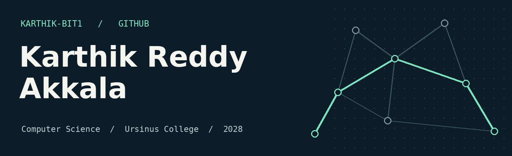

I build software for the parts users rarely see: how a game counts votes, how tests catch regressions, and how a database backs up its records. I’m looking for a **Summer 2027 software engineering internship**.

[Connect on LinkedIn ↗](https://www.linkedin.com/in/karthik-reddy-akkala-00aa221b8) · [Browse my repositories ↗](https://github.com/karthik-bit1?tab=repositories)

## Selected projects

### [Reverse Turing Test ↗](https://github.com/karthik-bit1/Group_Project)
*Team project · Software Engineering*

One human plays alongside four AI players. I developed the question and voting logic, integrated asynchronous calls for AI responses, and contributed tests and a GitHub Actions workflow.

`Python` · `Streamlit` · `Azure AI Inference SDK` · `pytest`

### [Hospital Medical Database ↗](https://github.com/karthik-bit1/CS377-A_hospital_medicaldb)
*Individual project · Database Systems*

I designed seven related tables for hospital records, wrote functions and stored procedures to retrieve patient histories and update records, and automated timestamped backups with a Bash script.

`PostgreSQL` · `SQL` · `Docker Compose` · `Bash`

<strong>More from my coursework</strong>

- Worked with Dijkstra’s algorithm and A* for shortest-path problems.
- Practiced object-oriented programming, pointers, and singly and doubly linked lists in C/C++ coursework.
- Completed the edX course *Data Science: Building Machine Learning Models* in February 2026.

